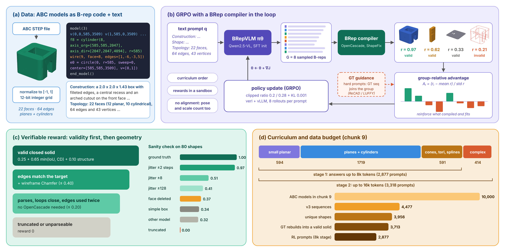

# RLTuned-CAD: GRPO for BRepVLM (text to B-rep)

RL side of the BRepVLM project. The model writes a B-rep sequence, a BRep compiler rebuilds it
with OpenCascade, a verifiable geometric reward scores it, and GRPO updates the model
(ReCAD-style, adapted to raw B-rep output). Built on [verl](https://github.com/volcengine/verl) v0.9.1.



## Headline results

Held-out chunk-9 test split (255 shapes whose GT rebuilds), greedy decoding, scored by one scorer for
every row (`scripts/eval.py`). Filled in from `results/comparison.md` as runs finish.

| Model | IR (invalid ratio) | IoU 128^3 | IoU_best | CD x1e3 (median) | reward |
|---|---|---|---|---|---|
| oracle (GT sequence as the answer) | 0.000 | 1.000 | 1.000 | sampling floor ~0.07 | 1.000 |
| SFT only (Qwen2.5-VL-3B, chunk 9) | run05 | | | | |
| SFT + GRPO 8k stage | run06 | | | | |

## How the RL stage works

1. **Prompt.** The three text descriptions of a part (construction steps, global shape, topology
   relations), ~600-1000 tokens. Image prompts come later (`brepgrpo/prompts.py`).
2. **Policy.** The SFT checkpoint writes 8 B-rep sequences per prompt (vLLM rollouts, 8k tokens in
   the first stage, 16k in the second).
3. **Compiler.** Each sequence is rebuilt into an OpenCascade solid (`brepgrpo/compiler_occ.py`, a
   stand-in until Bhavika's compiler plugs in through `brepgrpo/compiler.py`).
4. **Reward** (`brepgrpo/reward.py`), tiered so broken outputs still get a gradient:

   | Tier | Condition | Reward |
   |---|---|---|
   | 0 | truncated, no `end_model()`, unparseable | 0 |
   | 1 | parses: loops close, edges used twice, references valid (no OCC) | 0.05 + 0.15 · topo |
   | 2 | + edge-sampled ("wireframe") Chamfer to the GT edges | + 0.20 · topo · wire (max 0.40) |
   | 3 | compiles to a valid closed solid | 0.25 + 0.65 · min(IoU, CD-sim) + 0.10 · structure |

   `min(IoU, CD-sim)` is ReCAD's guard against gaming one metric. `structure` compares face / edge /
   vertex counts and the surface-type mix with the target, the numbers the text prompt states. Everything
   is compared in the canonical [-1, 1] frame with no alignment, so position, scale and orientation count.
5. **GRPO** (verl): group-relative advantages over the 8 samples, KL 0.001 to the SFT policy, clip
   0.2 / 0.28, LR 1e-6, curriculum by data order (small planar, planes + cylinders, other surfaces, complex).

## What is verified and what is not (yet)

Reproduced on CPU from the code in this repo (chunk 9, 4,477 sequences):

* parser: every sequence parses with zero bad lines
* stand-in compiler: **3,805 of 3,856** unique annotated GT sequences (98.7%) rebuild into valid closed
  solids; volumes match the annotation numbers (median error 0.1%, DATA_REPORT.md)
* reward: GT scores 1.000, every corruption scores lower in order of severity (table below)
* eval path: with the GT sequence standing in for the model output, IoU 1.000, invalid ratio 0 (`--oracle`)
* every verl override composes against verl v0.9.1's config tree (`tests/check_verl_configs.py`), and
  the reward entry point survives verl's by-value transfer into a separate process

Not run yet (needs Nova GPUs): SFT, GRPO and vLLM generation. That is why run01 ends with a preflight
and run03 is a 6-step GRPO smoke test before the real run.

Reward sanity (`scripts/reward_sanity.py`, 80 random chunk-9 shapes, 66 ms per sample on one core):

| Variant | Reward | Valid solid | IoU |
|---|---|---|---|
| ground truth | 1.000 | 1.00 | 1.000 |
| vertices jittered ±2 steps | 0.974 | 0.97 | 0.958 |
| jittered ±8 steps | 0.516 | 0.34 | 0.320 |
| jittered ±32 steps | 0.506 | 0.36 | 0.323 |
| jittered ±128 steps | 0.418 | 0.30 | 0.218 |
| one face deleted (invalid, close) | 0.385 | 0.01 | 0.012 |
| another model's GT | 0.321 | 1.00 | 0.078 |
| a simple box instead | 0.320 | 1.00 | 0.015 |
| edge order shuffled inside loops | 0.996 | 1.00 | 0.994 |
| truncated / empty | 0.000 | 0.00 | 0.000 |

A valid but wrong shape (0.32) does not beat a near miss (0.39), so the policy is not pushed toward
"emit any valid box". Jitter of 8 steps or more mostly breaks validity, so those rows sit close together.
The shuffled-loop row shows our compiler (ShapeFix) tolerates edge order inside a loop; Bhavika's may
not, one more reason to swap hers in early.

## Running it on Nova

Conventions as in VISTA-CAD: `scripts/runNN_name.sbatch` with the explanation in the header,
`scripts/_common.sh` holds the paths, `logs/<job>_<id>.log`, `results/` is tracked.

```bash
cd /work/mech-ai-scratch/mohd7 && git clone <repo url> RLTuned-CAD && cd RLTuned-CAD
bash scripts/setup_nova.sh                 # once, ~20-30 min, needs internet (OnDemand desktop / login node)
# copy Bhavika's BRepVLM folder (the two .tar.gz are enough) into data/BRepVLM, then
bash scripts/unpack_raw.sh data/BRepVLM
bash scripts/submit_chain.sh all           # run01 -> run02 -> run03 -> run04, run05 after run02
bash scripts/submit_chain.sh eval          # run06 on the newest GRPO export -> results/comparison.md
```

| Script | GPUs | What |
|---|---|---|
| `run01_prep.sbatch` | 0 | data prep, GT reward cache, reward sanity, preflight, oracle eval |
| `run02_sft_3b.sbatch` | 8 | stand-in SFT, Qwen2.5-VL-3B, 2 epochs (`BASE_MODEL=...7B-Instruct` for the paper setting) |
| `run03_grpo_smoke.sbatch` | 8 | 6 GRPO steps, short answers: proves one full step runs |
| `run04_grpo_8k.sbatch` | 8 | the main GRPO run (stop it any time; run06 takes the newest export) |
| `run05_eval_sft.sbatch` | 4 | SFT-only row |
| `run06_eval_grpo.sbatch` | 4 | SFT + GRPO row and `results/comparison.md` |

Every `.sbatch` is a plain bash script, so inside a Nova Desktop session with GPUs you can run
`bash scripts/run03_grpo_smoke.sbatch` directly; they use however many GPUs they see.
`GPUS=4 bash scripts/submit_chain.sh train` targets the 4-GPU A100 nodes. The runbook with the
verification gate for each stage is `docs/GRPO_RUNBOOK_2026-10.md`.

When Bhavika's checkpoint arrives: `POLICY=/path/to/her/hf EXP=grpo_8k_bh sbatch scripts/run04_grpo_8k.sbatch`
(skip our SFT). Match `brepgrpo/prompts.py` to her prompt format first.

### Knobs (environment variables, read by `scripts/_common.sh` and the launchers)

| Variable | Default | Meaning |
|---|---|---|
| `BASE_MODEL` | `Qwen/Qwen2.5-VL-3B-Instruct` | SFT starting point (7B is the paper setting) |
| `POLICY` | newest SFT export | GRPO starting point |
| `STAGE` | `8k` | `16k` adds the long (complex) shapes; start it from the 8k run's export |
| `N`, `BATCH`, `LR`, `KL` | 8, 64, 1e-6, 0.001 | rollouts per prompt, prompts per step, actor LR, KL coefficient |
| `STEPS` | all (2 epochs) | `trainer.total_training_steps`, e.g. `STEPS=30` for a fixed budget |
| `TP`, `GPU_UTIL` | 1, 0.6 | vLLM tensor parallel size and memory share |
| `BREP_COMPILER_MODULE` | (ours) | module or .py exposing `compile_sequence(text) -> TopoDS_Shape` (Bhavika's) |

## Next steps

1. **GT guidance for hard prompts (ReCAD / LUFFY).** Put the GT sequence into the GRPO group as one of
   the 8 samples on prompts where the policy keeps failing, with LUFFY's r/(r+0.1) weighting. Needs a
   small verl trainer subclass; written once the basic run works on Nova.
2. **16k stage:** `STAGE=16k POLICY=<8k export> EXP=grpo_16k sbatch scripts/run04_grpo_8k.sbatch`.
3. **Image-to-sequence** once renders arrive: an `images` column and `<image>` in the prompt; verl's
   dataset handles the rest.
4. **Bhavika's compiler:** set `BREP_COMPILER_MODULE`, rerun run01 to rebuild the GT cache.

## Troubleshooting

* GRPO never prints a step and Ray warns about pending actors: the reward workers did not get CPUs.
  `_grpo.sh` sizes them as `cores - 3 x GPUs - 2` (verl reserves 3 CPUs per GPU); request the full node
  (`--cpus-per-task=48` on the 8-GPU nodes) or lower `REWARD_WORKERS`.
* SFT stops with an `input_ids mismatch` message from verl's dataset check: append
  `data.ignore_input_ids_mismatch=True` to the sbatch call.
* vLLM out of memory in GRPO: `TP=2` or `GPU_UTIL=0.5`, or `BATCH=32`.
* `[brep reward] ...` lines in the GRPO log: a sample's OCC child crashed or timed out; it kept its
  topology reward and was flagged `timeout=1`. A steady stream of them means the compiler is unhappy with
  what the policy writes, look at `runs/<exp>/val_generations/`.

## Repo map

```
brepgrpo/     seqfmt (parse), checks (topology), compiler_occ + compiler (OCC), geometry, gtcache,
              reward, verl_reward (verl entry point), prompts, metrics_eval
scripts/      prepare_data, reward_sanity, eval, compare, unpack_raw, setup_nova, submit_chain,
              _common.sh + _sft.sh/_grpo.sh/_eval.sh launchers, run01..run06 sbatch
tests/        test_core (pytest), test_verl_reward, check_verl_configs, preflight_nova
docs/         GRPO_RUNBOOK_2026-10.md, prof_meeting_prep/
DATA_REPORT.md  what is in the data and what we ask Bhavika for
figures/      pipeline figure (figures/make_pipeline_figure.py)
```
